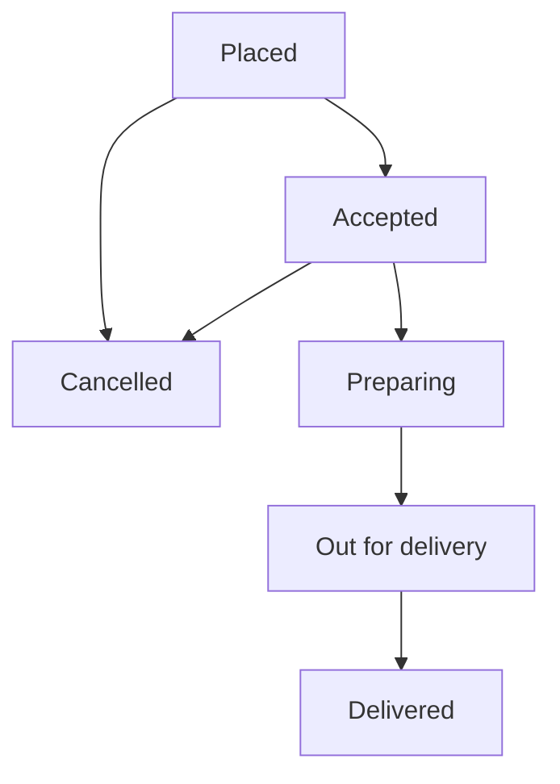

# Efood API

[](https://github.com/herick-gomes/efood-api/actions/workflows/ci.yml)

A food-delivery backend built with **Django REST Framework and PostgreSQL**, designed to connect to my [Efood React project](https://github.com/herick-gomes/Efood).

The interesting part of a checkout is what happens when things change: a price is edited, the last item sells out, or a customer taps the order button twice. This project handles those cases explicitly, with database transactions and tests.

**Portfolio demo:** payments are simulated. No card data is accepted, no charge is made and no real delivery is arranged.

## What it does

- Customer registration and JWT authentication, with rotating refresh tokens and logout revocation.
- Public restaurant menus and a read-only compatibility adapter for the existing React catalog.
- Merchant-owned restaurants and products, with availability and stock control.
- Orders priced on the server, with permanent item-name and price snapshots.
- Idempotent checkout: retrying the same request returns the existing order.
- Stock reservation inside a transaction; concurrent buyers cannot purchase the same last unit.
- Explicit order transitions and an event history.
- Customer cancellation before acceptance; merchant cancellation before preparation; stock restored once.
- OpenAPI/Swagger documentation, Docker Compose, PostgreSQL CI and automated tests.

## Quick start: Docker

```bash
cp .env.example .env
# PowerShell: Copy-Item .env.example .env
docker compose up --build
```

Open **http://127.0.0.1:8000/api/docs/**. The API is under `/api/v1/`. Compose binds only to localhost, and the example environment is for local development.

Set `EFOOD_DEMO_PASSWORD` in your shell, then create fictional data:

```bash
docker compose exec -e EFOOD_DEMO_PASSWORD api python manage.py seed_demo
```

The command creates `demo_customer`, `demo_merchant`, two fictional restaurants and four dishes. You choose the password; none is committed. Existing demo accounts are never overwritten.

See [the Windows guide](docs/GUIA_LOCAL.md) for a Python-only setup. PostgreSQL is required to exercise concurrency guarantees; SQLite is only a local convenience.

## Try a checkout

Get tokens through `POST /api/v1/auth/token/` using your local username and password. In Swagger, click **Authorize** and paste the access token (the UI supplies the Bearer prefix).

Then send `POST /api/v1/orders/`, with a fresh UUID in the `Idempotency-Key` header:

```json
{
  "items": [{ "product_id": 1, "quantity": 2 }],
  "delivery": {
    "receiver": "Demo Customer",
    "address": "Example Street",
    "city": "Niteroi",
    "zip_code": "24000-000",
    "number": "10",
    "complement": "Demo only"
  }
}
```

Use a product ID returned by the catalog. Only IDs and quantities are accepted: the client cannot choose the price, customer, payment status or order status.

- First successful request: **201**, stock reserved, `simulated_approved` payment.
- Same customer, key and normalized payload: **200**, same order, no second stock deduction.
- Same customer and key with different items or delivery: **409**.
- Insufficient stock or a closed restaurant: **409**; no partial order or stock deduction.

A retry returns the order's **current** status, even if it has since been cancelled. Keys are scoped to the customer and retained with the order. Failed requests do not reserve a key. Product ordering and postal-code punctuation are normalized before hashing the request.

## API map

| Endpoint | Access | Purpose |
|---|---|---|
| `POST /api/v1/auth/register/` | Public | Create a customer account only |
| `POST /api/v1/auth/token/` | Public | Obtain access and refresh tokens |
| `POST /api/v1/auth/refresh/` | Refresh token | Rotate tokens |
| `POST /api/v1/auth/logout/` | Refresh token | Revoke a refresh token |
| `GET /api/v1/auth/me/` | Authenticated | Read own account |
| `GET /api/v1/restaurants/` | Public | Paginated catalog |
| `GET /api/v1/legacy/restaurantes/` | Public | Existing React catalog shape |
| `GET/POST /api/v1/orders/` | Customer | Own history / place order |
| `GET /api/v1/orders/{id}/` | Customer | Own order details |
| `POST /api/v1/orders/{id}/cancel/` | Customer | Cancel a placed order |
| `/api/v1/merchant/restaurants/` | Merchant | Own restaurant CRUD; deletion archives |
| `/api/v1/merchant/products/` | Merchant | Own product CRUD; deletion archives |
| `GET /api/v1/merchant/orders/` | Merchant | Own restaurants' orders; optional `status` filter |
| `POST /api/v1/merchant/orders/{id}/transition/` | Merchant | Change status using `{"status":"accepted"}` |
| `/api/docs/` / `/api/schema/` | Public | Swagger UI / OpenAPI |
| `/health/` | Public | Process liveness, not database readiness |

Merchant roles are assigned by a trusted administrator, or by the local demo command. Public registration cannot create merchants or staff accounts. A restaurant owner cannot access another restaurant's orders or products.

## Order lifecycle



Customers can cancel only a placed order. Merchants can cancel placed or accepted orders. Repeating the current transition is a no-op, so stock and events are not duplicated. Delivered and cancelled orders are terminal.

## Design choices

**Transactions before abstractions.** Checkout locks the customer, restaurant and affected products in a consistent order. The customer lock serializes idempotency checks; restaurant and product locks coordinate stock and availability. PostgreSQL is the reference database.

**Snapshots instead of mutable history.** Each order stores the restaurant name and each line stores the product name, unit price, quantity and line total. Editing the catalog does not rewrite past purchases. Product and restaurant deletion is archival.

**Small scope, explicit rules.** One restaurant per order. All money is BRL and represented as decimal strings in the native API. There are no delivery fees, discounts or payment-provider integrations in this version. The legacy adapter alone exposes numeric prices to match the current React types.

**Frontend integration without a surprise deployment.** The companion frontend changes are prepared in [draft PR #1](https://github.com/herick-gomes/Efood/pull/1), on `feat/own-api-integration` in Efood. They replace card collection with sign-in and a simulated checkout, preserve retry keys, and show the total confirmed by the server. See [integration notes](docs/FRONTEND.md). The currently published site is not switched automatically.

## Verification

```bash
# Set DJANGO_DEBUG=1 and DATABASE_URL for a local PostgreSQL database first.
pip install -r requirements-dev.txt
python manage.py migrate
python manage.py collectstatic --noinput
ruff check .
ruff format --check .
pytest --cov=shop --cov-fail-under=90 --cov-report=term-missing
python manage.py spectacular --file schema.yml --validate --fail-on-warn
```

The suite checks tenant isolation, role escalation, JWT rotation/revocation, historical prices, invalid payloads, stock rollback, cancellation, status transitions and concurrent requests. The two concurrency scenarios are explicitly skipped on SQLite. Coverage excludes migrations, demo commands and Django admin; it is not a claim of complete security or frontend coverage.

## Before using with real customers

This is a portfolio implementation, not a live delivery business. Production work still includes account recovery and verification, shared-cache/distributed rate limiting, abuse protection, backups, monitoring, data retention, load testing and a real payment provider with signed webhooks. DRF throttling here uses process-local memory and is not a distributed security boundary. Refresh-token rotation is not a claim of atomic protection against concurrent refresh replay.

Access tokens expire after 15 minutes. Logout revokes the refresh token; an already-issued access token remains usable until expiry. Schedule Simple JWT's `flushexpiredtokens` command when deploying. Configure HTTPS, a strong external secret, allowed hosts and exact CORS origins. Never expose the local debug configuration.
